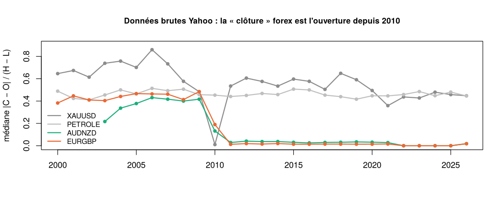
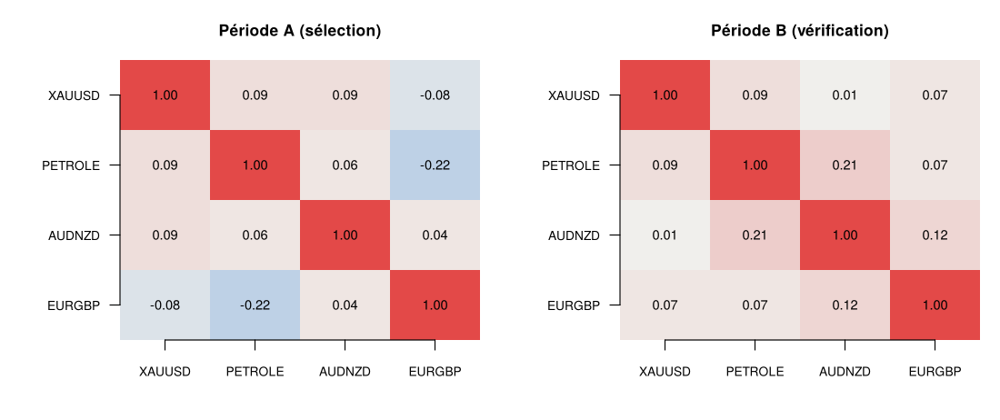
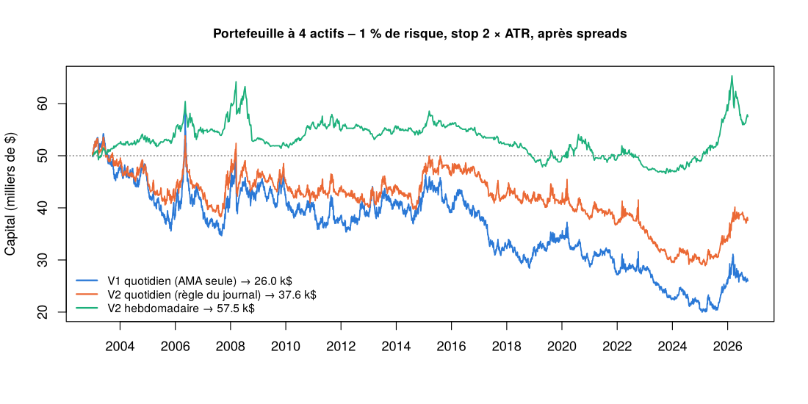

GES816 – Backtest de la règle V2 sur le portefeuille à 4 actifs
================
École de technologie supérieure, Montréal
01/11/2026

- [Objet](#objet)
- [Données](#données)
  - [Paquets](#paquets)
  - [Cours](#cours)
  - [Correction des clôtures forex de
    Yahoo](#correction-des-clôtures-forex-de-yahoo)
- [Choix des actifs](#choix-des-actifs)
- [Indicateurs (formules des
  diapositives)](#indicateurs-formules-des-diapositives)
- [Règle et moteur de backtest](#règle-et-moteur-de-backtest)
- [Résultats](#résultats)
  - [Par actif (quotidien, période
    complète)](#par-actif-quotidien-période-complète)
- [Contrôle sur la période du journal de
  trades](#contrôle-sur-la-période-du-journal-de-trades)
- [Exports](#exports)

<div style="font-family: Arial, Helvetica, sans-serif; border-top: 3px solid #333; border-bottom: 1px solid #ccc; padding: 8px 0; margin: 6px 0 22px 0;">
  <div style="font-size: 16px; font-weight: 700;">École de technologie supérieure · Montréal</div>
  <div style="font-size: 13.5px; color: #555;">GES816 – Méthodes et systèmes d'investissement · Automne 2026 · Professeur : Edmond T. Miresco</div>
</div>

# Objet

Ce document reproduit le backtest du chapitre 6.2 du rapport : la règle
V2 appliquée au portefeuille or (XAUUSD), pétrole, AUDNZD et EURGBP,
avec les règles de gestion du journal de trades.

| Élément           | Règle                                                                                                                                         |
|-------------------|-----------------------------------------------------------------------------------------------------------------------------------------------|
| Signal            | AMA Variation Method « Best » (diapo 98) : AMA de Kaufman (21, 2, 30), moyenne sur 2 barres, variation sur 2 barres lissée par EMA-21 (`per`) |
| Achat             | `per` ≥ 0, tendance hebdomadaire EMA-10 \> EMA-40 (semaines terminées, diapos 613-615) et ADX(14) ≥ 17 (diapos 250-253)                       |
| Vente à découvert | `per` \< 0, tendance hebdomadaire baissière et ADX(14) ≥ 17                                                                                   |
| Entrée            | à la clôture du jour où les trois conditions sont réunies                                                                                     |
| Stop              | fixe, à 2 × ATR(14) de Wilder du prix d’entrée, jamais déplacé                                                                                |
| Taille            | 1 % du capital / (2 × ATR × valeur du point)                                                                                                  |
| Sortie            | à la clôture dès qu’une condition tombe, ou au stop (à l’ouverture si elle le dépasse)                                                        |
| Frais             | spread aller-retour d’un compte démo ; swaps non modélisés                                                                                    |

Le document contient deux parties distinctes :

1.  **Le backtest** (sections « Choix des actifs » à « Résultats ») : la
    règle appliquée à l’historique, du 1<sup>er</sup> janvier 2003 au
    **25 septembre 2026**, dernière séance avant le début des trades.
    L’historique testé et la période de trading ne se chevauchent pas.
2.  **Le contrôle sur la période des trades** (dernière section) : le
    même code, relancé du 28 septembre au 30 octobre 2026, donne les
    décisions de la règle sur cette période, et les compare aux cinq
    trades de mon journal.

Le résultat d’un trade vaut 1 % × R, avec R = sens × (sortie − entrée) /
(2 × ATR) : il ne dépend pas de la devise de cotation. V1 est l’AMA
seule, toujours en position. La version hebdomadaire calcule la même
règle sur des barres hebdomadaires, avec la tendance de fond mensuelle.

Paramètres de cette exécution : source demandée = **csv**, période
**2003-01-01** à **2026-09-25**, pétrole = **CL=F**.

# Données

## Paquets

Les paquets manquants sont installés automatiquement (une seule fois),
puis chargés.

``` r
paquets <- c("quantmod", "xts", "zoo", "knitr", "rmarkdown")
manquants <- paquets[!vapply(paquets, requireNamespace, logical(1), quietly = TRUE)]
if (length(manquants)) install.packages(manquants, repos = "https://cloud.r-project.org")
suppressPackageStartupMessages({ library(quantmod); library(xts); library(zoo) })
```

## Cours

Les cours quotidiens viennent de Yahoo Finance (`quantmod::getSymbols`).
L’or est le contrat à terme GC=F ; le pétrole est le contrat à terme WTI
(CL=F) par défaut, ou l’ETF USO si `petrole = "USO"`. Avec
`source = "csv"`, le document lit le fichier fourni, qui contient les
cours utilisés dans le rapport ; si le téléchargement Yahoo échoue, il
utilise aussi ce fichier.

``` r
TICKERS <- c(XAUUSD = "GC=F", PETROLE = params$petrole, AUDNZD = "AUDNZD=X", EURGBP = "EURGBP=X")
SPREAD  <- c(XAUUSD = 0.30, PETROLE = if (params$petrole == "USO") 0.02 else 0.04, AUDNZD = 0.00035, EURGBP = 0.00015)

nettoyer <- function(df) {
  df <- df[complete.cases(df), ]
  df <- df[order(df$date), ]
  df <- df[!duplicated(df$date, fromLast = TRUE), ]   # une seule barre par date
  df$high <- pmax(df$high, df$open, df$close)   # corrige les ticks aberrants
  df$low  <- pmin(df$low,  df$open, df$close)
  df
}

date_seance <- function(dates, tk) {
  # quantmod transforme l'heure Yahoo en date avec as.Date(), c'est-à-dire en temps universel (UTC). Une barre forex
  # commence à minuit à Londres : à l'heure d'été (fin mars à fin octobre), minuit à Londres = 23 h UTC la veille, et la
  # date recule d'un jour (lundi -> dimanche, vendredi -> jeudi). On rétablit la date de Londres. On garde la version
  # sans séances le week-end, pour rester juste si une future version de quantmod corrige elle-même la date.
  if (!grepl("=X$", tk)) return(dates)               # or et pétrole (New York) : date déjà juste
  ete <- as.POSIXlt(as.POSIXct(format(dates + 1), tz = "Europe/London"))$isdst > 0
  corrigees <- dates + as.integer(ete)
  week_end <- function(d) sum(format(d, "%u") %in% c("6", "7"))
  if (week_end(corrigees) < week_end(dates)) corrigees else dates
}

lire_yahoo <- function(tk, de, a) {
  x <- tryCatch(getSymbols(tk, src = "yahoo", from = de, to = as.Date(a) + 1, auto.assign = FALSE),
                error = function(e) stop("Téléchargement Yahoo impossible pour ", tk, " : ", conditionMessage(e)))
  nettoyer(data.frame(date = date_seance(as.Date(index(x)), tk), open = as.numeric(Op(x)), high = as.numeric(Hi(x)),
                      low = as.numeric(Lo(x)), close = as.numeric(Cl(x))))
}

lire_csv <- function(f) {
  if (!file.exists(f)) stop("Fichier introuvable : ", f, " (il doit être dans le même dossier que ce .Rmd)")
  tab <- read.csv(f, stringsAsFactors = FALSE)
  tab$date <- as.Date(tab$date)
  b <- lapply(names(TICKERS), function(n) {
    d <- tab[tab$actif == n, c("date", "open", "high", "low", "close")]
    d$date <- date_seance(d$date, TICKERS[[n]])       # répare aussi un fichier téléchargé avec les dates décalées
    nettoyer(d)
  })
  setNames(b, names(TICKERS))
}

source_utilisee <- params$source
fin_donnees <- max(as.Date(params$fin), as.Date(params$fin_controle))   # cours utilisés jusqu'à la fin du contrôle
if (params$source == "yahoo") {
  # une semaine de plus : la vraie clôture forex d'un jour vient de la barre suivante (section 2.3)
  brut <- tryCatch(lapply(TICKERS, lire_yahoo, de = params$debut_donnees, a = fin_donnees + 7),
                   error = function(e) { message(conditionMessage(e)); NULL })
  if (is.null(brut)) {
    source_utilisee <- "csv (téléchargement Yahoo impossible)"
    brut <- lire_csv(params$fichier_csv)
  } else {
    # copie des cours téléchargés, dans un fichier distinct pour ne pas écraser les données du rapport
    sauvegarde <- do.call(rbind, Map(function(d, n) cbind(actif = n, d), brut, names(brut)))
    # 17 chiffres significatifs : relu en mode csv, le fichier redonne exactement les mêmes résultats
    # (write.csv n'en garde que 15, assez pour faire basculer un indicateur situé pile sur un seuil)
    for (k in c("open", "high", "low", "close")) sauvegarde[[k]] <- sprintf("%.17g", sauvegarde[[k]])
    write.csv(sauvegarde, "donnees_yahoo_telechargees.csv", row.names = FALSE, quote = FALSE)
  }
} else {
  brut <- lire_csv(params$fichier_csv)
}
vue <- lapply(brut, function(d) d[d$date <= fin_donnees, ])
knitr::kable(data.frame(Actif = names(vue), Ticker = TICKERS, Début = sapply(vue, function(d) format(min(d$date))),
                        Fin = sapply(vue, function(d) format(max(d$date))), Séances = sapply(vue, nrow),
                        `Séances un samedi ou un dimanche (doit être 0)` = sapply(vue, function(d) sum(format(d$date, "%u") %in% c("6", "7"))),
                        row.names = NULL, check.names = FALSE))
```

| Actif   | Ticker   | Début      | Fin        | Séances | Séances un samedi ou un dimanche (doit être 0) |
|:--------|:---------|:-----------|:-----------|--------:|-----------------------------------------------:|
| XAUUSD  | GC=F     | 2000-08-30 | 2026-10-30 |    6568 |                                              0 |
| PETROLE | CL=F     | 2000-08-23 | 2026-10-30 |    6576 |                                              0 |
| AUDNZD  | AUDNZD=X | 2003-12-01 | 2026-10-30 |    5965 |                                              0 |
| EURGBP  | EURGBP=X | 2000-01-03 | 2026-10-30 |    6986 |                                              0 |

Source des données utilisée : **csv**.

## Correction des clôtures forex de Yahoo

Depuis 2010 environ, la « clôture » quotidienne des paires de devises de
Yahoo (`=X`) est en fait le prix d’ouverture de la barre : le plus haut
et le plus bas de la barre sont postérieurs à cette « clôture ». Sans
correction, l’ADX et l’ATR verraient la journée suivante. Le défaut est
détecté quand, sur 60 jours glissants, la médiane de \|C − O\| / (H − L)
est inférieure à 0,15 et celle de \|C − O(t+1)\| / (H − L) supérieure à
0,30. Pendant ces périodes, la vraie clôture du jour t est la « clôture
» Yahoo de t + 1 (marché continu 24 h).

``` r
mediane_glissante <- function(x, n = 60, min_obs = 40) {
  sapply(seq_along(x), function(i) {
    v <- x[max(1, i - n + 1):i]; v <- v[!is.na(v)]
    if (length(v) >= min_obs) median(v) else NA_real_
  })
}
corriger_fx <- function(df) {
  rng <- df$high - df$low; rng[rng == 0] <- NA
  ouv_suiv <- c(df$open[-1], NA)
  a <- mediane_glissante(abs(df$close - df$open) / rng)
  b <- mediane_glissante(abs(df$close - ouv_suiv) / rng)
  defaut <- !is.na(a) & !is.na(b) & a < 0.15 & b > 0.30
  if (sum(defaut) < 60) return(list(df = df, defaut = defaut))
  clo_suiv <- c(df$close[-1], NA)
  df$close[defaut] <- clo_suiv[defaut]
  garder <- !is.na(df$close)
  df <- df[garder, ]
  df$high <- pmax(df$high, df$open, df$close); df$low <- pmin(df$low, df$open, df$close)
  list(df = df, defaut = defaut[garder])
}

donnees <- vue
diag <- list()
for (fx in c("AUDNZD", "EURGBP")) {
  res <- corriger_fx(brut[[fx]])                       # correction sur les cours complets, puis coupe à la fin du contrôle
  garder <- res$df$date <= fin_donnees
  donnees[[fx]] <- res$df[garder, ]; res$defaut <- res$defaut[garder]
  d <- donnees[[fx]]$date[res$defaut]
  diag[[fx]] <- data.frame(Paire = fx, `Jours corrigés` = sum(res$defaut), `Part des jours` = sprintf("%.0f %%", 100 * mean(res$defaut)),
                           `Premier jour` = if (length(d)) format(min(d)) else "—", `Dernier jour` = if (length(d)) format(max(d)) else "—",
                           check.names = FALSE)
}
knitr::kable(do.call(rbind, diag), row.names = FALSE)
```

| Paire  | Jours corrigés | Part des jours | Premier jour | Dernier jour |
|:-------|---------------:|:---------------|:-------------|:-------------|
| AUDNZD |           4083 | 68 %           | 2010-10-12   | 2026-10-30   |
| EURGBP |           4192 | 60 %           | 2010-09-24   | 2026-10-29   |

``` r
ratio_annuel <- function(df) {
  r <- abs(df$close - df$open) / ifelse(df$high > df$low, df$high - df$low, NA)
  tapply(r, format(df$date, "%Y"), median, na.rm = TRUE)
}
ra <- lapply(brut, ratio_annuel)
ans <- sort(unique(unlist(lapply(ra, names))))
plot(NA, xlim = range(as.integer(ans)), ylim = c(0, 0.9), xlab = "", ylab = "médiane |C − O| / (H − L)",
     main = "Données brutes Yahoo : la « clôture » forex est l'ouverture depuis 2010", cex.main = 0.95)
cols <- c(XAUUSD = "grey55", PETROLE = "grey75", AUDNZD = "#1baf7a", EURGBP = "#eb6834")
for (n in names(ra)) lines(as.integer(names(ra[[n]])), ra[[n]], col = cols[n], lwd = 2, type = "o", pch = 20)
legend("bottomleft", legend = names(ra), col = cols[names(ra)], lwd = 2, bty = "n", cex = 0.85)
```

<!-- -->

# Choix des actifs

Le portefeuille a été choisi **avant tout backtest**, sur des critères
de diversification et non de performance. Les quatre critères :

1.  **Des classes d’actifs différentes**, dont les prix dépendent de
    facteurs économiques distincts.
2.  **Une faible corrélation hebdomadaire** : \|r\| ≤ 0,30 entre toutes
    les paires sur la période de sélection (A : octobre 2016 – septembre
    2021), puis vérification sur la période suivante (B : octobre 2021 –
    septembre 2026).
3.  **Des rendements hebdomadaires plutôt que quotidiens.** Les marchés
    ne ferment pas à la même heure (les devises à minuit à Londres, l’or
    et le pétrole à New York), donc la corrélation quotidienne
    sous-estime leur dépendance. Les positions durant plusieurs
    semaines, c’est la corrélation hebdomadaire qui compte.
4.  **Des actifs négociables sur le compte démo.** Le panier retenu au
    départ (or, WTI, Nikkei, AUDNZD, EURGBP) a été ramené à quatre
    actifs : le trading du Nikkei est désactivé sur le compte, et le
    seul pétrole négociable est l’ETF USO (le backtest utilise le
    contrat à terme WTI, qu’USO suit de près). La sélection parmi 23
    instruments est faite dans le code Python du dépôt ; ce document
    vérifie le résultat sur les quatre actifs retenus.

``` r
classes <- data.frame(
  Actif = c("XAUUSD", "PETROLE", "AUDNZD", "EURGBP"),
  Classe = c("Métal précieux", "Énergie", "Devise croisée (Océanie)", "Devise croisée (Europe)"),
  `Principaux moteurs du prix` = c("Taux réels, dollar, demande de valeur refuge",
                                   "Offre et demande mondiales de pétrole, OPEP+",
                                   "Écart de politique monétaire Australie / Nouvelle-Zélande, matières premières",
                                   "Écart de politique monétaire zone euro / Royaume-Uni"),
  check.names = FALSE)
knitr::kable(classes)
```

| Actif   | Classe                   | Principaux moteurs du prix                                                    |
|:--------|:-------------------------|:------------------------------------------------------------------------------|
| XAUUSD  | Métal précieux           | Taux réels, dollar, demande de valeur refuge                                  |
| PETROLE | Énergie                  | Offre et demande mondiales de pétrole, OPEP+                                  |
| AUDNZD  | Devise croisée (Océanie) | Écart de politique monétaire Australie / Nouvelle-Zélande, matières premières |
| EURGBP  | Devise croisée (Europe)  | Écart de politique monétaire zone euro / Royaume-Uni                          |

``` r
A_sel <- as.Date(c("2016-10-01", "2021-09-30")); B_ver <- as.Date(c("2021-10-01", params$fin))
rend_log <- function(freq) {                                # rendements log, quotidiens ou hebdomadaires (vendredi)
  s <- lapply(names(donnees), function(a) {
    d <- donnees[[a]]; d <- d[d$close > 0 & d$date <= as.Date(params$fin), ]   # WTI négatif d'avril 2020 exclu
    if (freq == "W") {
      e <- d$date + ((5 - as.integer(format(d$date, "%u"))) %% 7)   # vendredi de la semaine
      v <- tapply(d$close, e, function(x) x[length(x)])             # dernière clôture de la semaine
      zoo(as.numeric(v), as.Date(names(v)))
    } else zoo(d$close, d$date)
  })
  m <- do.call(merge, s); colnames(m) <- names(donnees)
  diff(log(m), na.pad = TRUE)
}
correlation <- function(r, periode) cor(coredata(window(r, start = periode[1], end = periode[2])), use = "pairwise.complete.obs")
max_hors_diag <- function(C) max(abs(C[upper.tri(C)]))
rW <- rend_log("W"); rD <- rend_log("D")
CA <- correlation(rW, A_sel); CB <- correlation(rW, B_ver)
knitr::kable(round(CA, 2), caption = "Corrélation des rendements log hebdomadaires – période A (sélection, oct. 2016 – sept. 2021)")
```

|         | XAUUSD | PETROLE | AUDNZD | EURGBP |
|:--------|-------:|--------:|-------:|-------:|
| XAUUSD  |   1.00 |    0.09 |   0.09 |  -0.08 |
| PETROLE |   0.09 |    1.00 |   0.06 |  -0.22 |
| AUDNZD  |   0.09 |    0.06 |   1.00 |   0.04 |
| EURGBP  |  -0.08 |   -0.22 |   0.04 |   1.00 |

Corrélation des rendements log hebdomadaires – période A (sélection,
oct. 2016 – sept. 2021)

``` r
knitr::kable(round(CB, 2), caption = sprintf("Corrélation des rendements log hebdomadaires – période B (vérification, oct. 2021 – %s)", format(as.Date(params$fin), "%d/%m/%Y")))
```

|         | XAUUSD | PETROLE | AUDNZD | EURGBP |
|:--------|-------:|--------:|-------:|-------:|
| XAUUSD  |   1.00 |    0.09 |   0.01 |   0.07 |
| PETROLE |   0.09 |    1.00 |   0.21 |   0.07 |
| AUDNZD  |   0.01 |    0.21 |   1.00 |   0.12 |
| EURGBP  |   0.07 |    0.07 |   0.12 |   1.00 |

Corrélation des rendements log hebdomadaires – période B (vérification,
oct. 2021 – 25/09/2026)

``` r
verif <- data.frame(Période = c("A (sélection)", "B (vérification)"),
                    `|r| max hebdomadaire` = round(c(max_hors_diag(CA), max_hors_diag(CB)), 2),
                    `|r| max quotidien` = round(c(max_hors_diag(correlation(rD, A_sel)), max_hors_diag(correlation(rD, B_ver))), 2),
                    `Critère |r| ≤ 0,30` = ifelse(c(max_hors_diag(CA), max_hors_diag(CB)) <= 0.30, "respecté", "NON respecté"),
                    check.names = FALSE)
knitr::kable(verif)
```

| Période          | \|r\| max hebdomadaire | \|r\| max quotidien | Critère \|r\| ≤ 0,30 |
|:-----------------|-----------------------:|--------------------:|:---------------------|
| A (sélection)    |                   0.22 |                0.13 | respecté             |
| B (vérification) |                   0.21 |                0.15 | respecté             |

``` r
op <- par(mfrow = c(1, 2), mar = c(4, 6, 3, 1))
for (k in 1:2) {
  C <- list(CA, CB)[[k]]; n <- ncol(C)
  image(1:n, 1:n, t(C)[, n:1], zlim = c(-1, 1), col = colorRampPalette(c("#2a78d6", "#f0efec", "#e34948"))(41),
        axes = FALSE, xlab = "", ylab = "", main = c("Période A (sélection)", "Période B (vérification)")[k], cex.main = 0.95)
  axis(1, 1:n, colnames(C), cex.axis = 0.75, las = 1); axis(2, 1:n, rev(colnames(C)), las = 1, cex.axis = 0.75)
  for (i in 1:n) for (j in 1:n) text(j, n + 1 - i, sprintf("%.2f", C[i, j]), cex = 0.8)
}
```

<!-- -->

``` r
par(op)
```

``` r
vol_bh <- do.call(rbind, lapply(names(donnees), function(a) {
  d <- donnees[[a]]; d <- d[d$date >= B_ver[1] & d$date <= B_ver[2] & d$close > 0, ]
  ans <- as.numeric(diff(B_ver)) / 365.25
  data.frame(Actif = a, `Volatilité annuelle (B)` = sprintf("%.1f %%", 100 * sd(diff(log(d$close))) * sqrt(252)),
             `Buy & Hold par an (B)` = sprintf("%+.1f %%", 100 * ((tail(d$close, 1) / d$close[1])^(1 / ans) - 1)), check.names = FALSE)
}))
knitr::kable(vol_bh)
```

| Actif   | Volatilité annuelle (B) | Buy & Hold par an (B) |
|:--------|:------------------------|:----------------------|
| XAUUSD  | 19.1 %                  | +19.8 %               |
| PETROLE | 41.8 %                  | +4.0 %                |
| AUDNZD  | 4.7 %                   | +3.4 %                |
| EURGBP  | 8.7 %                   | +0.1 %                |

Les quatre actifs viennent de classes différentes et leur corrélation
hebdomadaire reste faible sur les deux périodes : le critère fixé avant
les tests est respecté. La volatilité varie d’un facteur proche de 9
entre AUDNZD et le pétrole : c’est pourquoi chaque position est
dimensionnée par le risque (1 % du capital, stop à 2 × ATR) et non par
le montant investi.

# Indicateurs (formules des diapositives)

``` r
decale <- function(x, k = 1) {                        # k > 0 : valeur passée ; k < 0 : valeur future
  n <- length(x); if (k == 0) return(x)
  if (k > 0) c(rep(NA, k), x[seq_len(n - k)]) else c(x[(1 - k):n], rep(NA, -k))
}
somme_glissante <- function(x, n) as.numeric(stats::filter(x, rep(1, n), sides = 1))

ema_ab <- function(x, n) {                            # diapo 96 : EMA amorcée sur la 1re valeur, 2/(n+1)
  a <- 2 / (n + 1); out <- rep(NA_real_, length(x)); debut <- FALSE
  for (i in seq_along(x)) {
    if (is.na(x[i])) { if (debut) out[i] <- out[i - 1]; next }
    out[i] <- if (!debut) x[i] else a * x[i] + (1 - a) * out[i - 1]; debut <- TRUE
  }
  out
}
ama_kaufman <- function(c, n = 21, rapide = 2, lente = 30) {   # diapo 96
  er <- abs(c - decale(c, n)) / somme_glissante(abs(c - decale(c, 1)), n)
  f <- 2 / (rapide + 1); s <- 2 / (lente + 1); sc <- (er * (f - s) + s)^2
  out <- rep(NA_real_, length(c)); prec <- NA_real_
  for (i in seq_along(c)) {
    if (!is.na(sc[i]) && !is.na(c[i])) prec <- if (is.na(prec)) c[i] else sc[i] * c[i] + (1 - sc[i]) * prec
    out[i] <- prec
  }
  out
}
ama_variation <- function(c, n = 21) {                # diapo 98 : AMA « Best »
  a <- ama_kaufman(c, n); a <- (a + decale(a, 1)) / 2  # MA(AMA, 2)
  ema_ab(a - decale(a, 2), n)                           # per = EMA(AMA - Ref(AMA, -2), 21)
}
adx_wilder <- function(h, l, c, n = 14) {             # diapo 250 : sommation de Welles Wilder
  N <- length(c); tr <- rep(NA_real_, N); pdm <- rep(0, N); mdm <- rep(0, N)
  for (i in 2:N) {
    tr[i] <- max(h[i] - l[i], abs(h[i] - c[i - 1]), abs(l[i] - c[i - 1]))
    hi <- h[i] - h[i - 1]; lo <- l[i - 1] - l[i]
    if ((hi < 0 && lo < 0) || hi == lo) next
    if (hi > lo) pdm[i] <- hi else mdm[i] <- lo
  }
  wsum <- function(x) {
    o <- rep(NA_real_, N); if (N <= n + 1) return(o)
    o[n + 1] <- sum(x[2:(n + 1)], na.rm = TRUE)
    for (i in (n + 2):N) o[i] <- x[i] + o[i - 1] * (n - 1) / n
    o
  }
  str <- wsum(tr); sp <- wsum(pdm); sm <- wsum(mdm)
  pdi <- 100 * sp / str; mdi <- 100 * sm / str; dx <- 100 * abs(pdi - mdi) / (pdi + mdi)
  adx <- rep(NA_real_, N)
  if (N > 2 * n + 1) {
    adx[2 * n + 1] <- mean(dx[(n + 2):(2 * n + 1)], na.rm = TRUE)
    for (i in (2 * n + 2):N) adx[i] <- (adx[i - 1] * (n - 1) + (if (is.na(dx[i])) adx[i - 1] else dx[i])) / n
  }
  adx
}
atr_wilder <- function(h, l, c, n = 14) {
  cp <- decale(c, 1)
  tr <- pmax(h - l, abs(h - cp), abs(l - cp), na.rm = TRUE)
  out <- numeric(length(tr)); out[1] <- tr[1]
  for (i in 2:length(tr)) out[i] <- (1 - 1 / n) * out[i - 1] + tr[i] / n
  out
}
vendredi <- function(d) d + ((5 - as.integer(format(d, "%u"))) %% 7)       # semaine terminée le vendredi
fin_de_mois <- function(d) { p <- as.Date(format(d, "%Y-%m-01")); as.Date(format(p + 32, "%Y-%m-01")) - 1 }
tendance_superieure <- function(dates, close, horizon) {
  # D : tendance hebdomadaire, connue le vendredi soir, appliquée à partir du lundi ; W : tendance mensuelle
  etiq <- if (horizon == "D") vendredi(dates) else fin_de_mois(dates)
  dern <- tapply(close, etiq, function(v) v[length(v)])
  e <- as.Date(names(dern)); v <- as.numeric(dern)
  t <- sign(ema_ab(v, 10) - ema_ab(v, 40))
  if (horizon == "D") e <- e + 1
  k <- findInterval(as.numeric(dates), as.numeric(e))
  out <- ifelse(k == 0, 0, t[pmax(k, 1)]); out[is.na(out)] <- 0
  out
}
barres_hebdo <- function(df) {
  w <- vendredi(df$date)
  data.frame(date = as.Date(sort(unique(w))),
             open = as.numeric(tapply(df$open, w, function(v) v[1])), high = as.numeric(tapply(df$high, w, max)),
             low = as.numeric(tapply(df$low, w, min)), close = as.numeric(tapply(df$close, w, function(v) v[length(v)])))
}
```

# Règle et moteur de backtest

``` r
signal <- function(df, horizon, version) {
  per <- ama_variation(df$close, 21)
  s <- ifelse(is.na(per), 0, ifelse(per >= 0, 1, -1))
  if (version == "V1") return(s)
  adx_ok <- adx_wilder(df$high, df$low, df$close, 14) >= 17; adx_ok[is.na(adx_ok)] <- FALSE
  ifelse(s == tendance_superieure(df$date, df$close, horizon) & adx_ok, s, 0)
}

backtest_actif <- function(df, spread, horizon = "D", version = "V2", debut = params$debut, fin = params$fin) {
  b <- if (horizon == "D") df else barres_hebdo(df)
  W <- signal(b, horizon, version); A <- atr_wilder(b$high, b$low, b$close)
  N <- nrow(b); mauvais0 <- b$close <= 0
  mauvais <- sapply(seq_len(N), function(i) any(mauvais0[max(1, i - 5):min(N, i + 5)]))   # WTI, avril 2020
  o <- b$open; h <- b$high; l <- b$low; c <- b$close
  i0 <- which(b$date >= as.Date(debut))[1]; i1 <- sum(b$date <= as.Date(fin))
  tr <- list(); pos <- NULL
  for (i in i0:i1) {
    if (!is.null(pos)) {
      px <- NA; motif <- NA
      if (mauvais[i]) { px <- c[i - 1]; motif <- "Données invalides"
      } else if (pos$sens > 0 && l[i] <= pos$stop) { px <- min(o[i], pos$stop); motif <- "Stop"
      } else if (pos$sens < 0 && h[i] >= pos$stop) { px <- max(o[i], pos$stop); motif <- "Stop"
      } else if (W[i] != pos$sens) { px <- c[i]; motif <- if (W[i] == 0) "Condition tombée" else "Signal inverse" }
      if (!is.na(px)) {
        brut_R <- pos$sens * (px - pos$px) / pos$risque
        tr[[length(tr) + 1]] <- data.frame(i_entree = pos$i, i_sortie = i, Entrée = b$date[pos$i], Sortie = b$date[i],
          Sens = ifelse(pos$sens > 0, "Achat", "Vente"), `Prix entrée` = pos$px, Stop = pos$stop, `Prix sortie` = px,
          `R brut` = brut_R, `R net` = brut_R - spread / pos$risque, Motif = motif, check.names = FALSE)
        pos <- NULL
      }
    }
    if (is.null(pos) && W[i] != 0 && !mauvais[i] && is.finite(A[i]) && A[i] > 0 && i < i1) {
      rp <- params$multiple_atr * A[i]
      pos <- list(i = i, sens = W[i], px = c[i], risque = rp, stop = c[i] - W[i] * rp)
    }
  }
  if (!is.null(pos)) {                                 # position encore ouverte : évaluée à la dernière clôture
    brut_R <- pos$sens * (c[i1] - pos$px) / pos$risque
    tr[[length(tr) + 1]] <- data.frame(i_entree = pos$i, i_sortie = i1, Entrée = b$date[pos$i], Sortie = b$date[i1],
      Sens = ifelse(pos$sens > 0, "Achat", "Vente"), `Prix entrée` = pos$px, Stop = pos$stop, `Prix sortie` = c[i1],
      `R brut` = brut_R, `R net` = brut_R - spread / pos$risque, Motif = "Ouverte (fin des données)", check.names = FALSE)
  }
  trades <- if (length(tr)) do.call(rbind, tr) else data.frame()
  # courbe en R au jour le jour (valeur de marché des positions ouvertes)
  R <- rep(0, i1 - i0 + 1)
  if (nrow(trades)) for (k in seq_len(nrow(trades))) {
    t <- trades[k, ]; seg <- c[t$i_entree:t$i_sortie]; seg[length(seg)] <- t$`Prix sortie`
    sens <- ifelse(t$Sens == "Achat", 1, -1)
    rr <- sens * (seg - t$`Prix entrée`) / abs(t$`Prix entrée` - t$Stop)
    inc <- diff(rr); inc[length(inc)] <- inc[length(inc)] - (t$`R brut` - t$`R net`)
    j <- (t$i_entree + 1):t$i_sortie - i0 + 1
    R[j] <- R[j] + inc
  }
  list(trades = trades, R = zoo(R, b$date[i0:i1]))
}

portefeuille <- function(horizon = "D", version = "V2") {
  res <- lapply(names(donnees), function(a) backtest_actif(donnees[[a]], SPREAD[[a]], horizon, version))
  names(res) <- names(donnees)
  R <- do.call(merge, lapply(res, `[[`, "R"))           # union des dates des 4 actifs
  m <- coredata(R); m[is.na(m)] <- 0                     # actif sans séance ce jour-là : 0
  rend <- zoo(params$risque * rowSums(m), index(R))
  list(par_actif = res, rend = rend, capital = params$capital * cumprod(1 + rend))
}

statistiques <- function(trades, rend, ppa) {
  q <- params$capital * cumprod(1 + coredata(rend)); ans <- as.numeric(diff(range(index(rend)))) / 365.25
  Rn <- trades$`R net`; m <- mean(rend); s <- sd(rend)
  data.frame(Trades = length(Rn), `Trades par an` = length(Rn) / ans, Réussite = mean(Rn > 0), `R moyen` = mean(Rn),
             `Rendement par an` = (q[length(q)] / params$capital)^(1 / ans) - 1, Volatilité = s * sqrt(ppa),
             Sharpe = m / s * sqrt(ppa), t = m / s * sqrt(length(rend)), `Drawdown max` = min(q / cummax(q) - 1),
             check.names = FALSE)
}
```

# Résultats

``` r
PERIODES <- list(`Complète` = c(params$debut, params$fin), `2003-2016` = c("2003-01-01", "2016-09-30"),
                 `2016-2021` = c("2016-10-01", "2021-09-30"), `2021-2026` = c("2021-10-01", params$fin))
lignes <- list(); runs <- list()
for (hz in c("D", "W")) for (v in c("V1", "V2")) {
  p <- portefeuille(hz, v); runs[[paste(hz, v)]] <- p
  tous <- do.call(rbind, lapply(names(p$par_actif), function(a) cbind(Actif = a, p$par_actif[[a]]$trades)))
  for (nom in names(PERIODES)) {
    s <- as.Date(PERIODES[[nom]][1]); e <- as.Date(PERIODES[[nom]][2])
    r <- window(p$rend, start = s, end = e)
    t <- tous[tous$Entrée >= s & tous$Entrée <= e, ]
    lignes[[length(lignes) + 1]] <- cbind(Horizon = ifelse(hz == "D", "Quotidien", "Hebdomadaire"), Version = v, Période = nom,
                                         statistiques(t, r, ifelse(hz == "D", 252, 52)))
  }
}
synthese <- do.call(rbind, lignes)
pct <- c("Réussite", "Rendement par an", "Volatilité", "Drawdown max")
aff <- synthese
for (k in pct) aff[[k]] <- sprintf("%.1f %%", 100 * aff[[k]])
for (k in c("Trades par an", "R moyen", "Sharpe", "t")) aff[[k]] <- sprintf("%.2f", aff[[k]])
knitr::kable(aff, row.names = FALSE, align = "lllrrrrrrrrr")
```

| Horizon      | Version | Période   | Trades | Trades par an | Réussite | R moyen | Rendement par an | Volatilité | Sharpe |     t | Drawdown max |
|:-------------|:--------|:----------|-------:|--------------:|---------:|--------:|-----------------:|-----------:|-------:|------:|-------------:|
| Quotidien    | V1      | Complète  |    869 |         36.62 |   28.3 % |   -0.05 |           -2.7 % |     14.4 % |  -0.11 | -0.56 |      -66.0 % |
| Quotidien    | V1      | 2003-2016 |    504 |         36.66 |   29.2 % |   -0.01 |           -1.9 % |     14.7 % |  -0.05 | -0.18 |      -41.0 % |
| Quotidien    | V1      | 2016-2021 |    188 |         37.67 |   27.7 % |   -0.14 |           -4.5 % |     11.6 % |  -0.32 | -0.73 |      -29.7 % |
| Quotidien    | V1      | 2021-2026 |    177 |         35.52 |   26.6 % |   -0.04 |           -3.3 % |     15.9 % |  -0.13 | -0.29 |      -36.7 % |
| Quotidien    | V2      | Complète  |    748 |         31.52 |   34.5 % |   -0.02 |           -1.2 % |     11.1 % |  -0.05 | -0.24 |      -46.3 % |
| Quotidien    | V2      | 2003-2016 |    430 |         31.28 |   37.0 % |    0.01 |           -0.4 % |     11.3 % |   0.02 |  0.09 |      -28.9 % |
| Quotidien    | V2      | 2016-2021 |    153 |         30.65 |   28.1 % |   -0.11 |           -3.8 % |      9.2 % |  -0.36 | -0.83 |      -21.1 % |
| Quotidien    | V2      | 2021-2026 |    165 |         33.11 |   33.9 % |    0.01 |           -0.7 % |     12.3 % |   0.01 |  0.02 |      -30.4 % |
| Hebdomadaire | V1      | Complète  |    182 |          7.67 |   24.2 % |    0.01 |           -0.2 % |      6.9 % |   0.01 |  0.03 |      -40.2 % |
| Hebdomadaire | V1      | 2003-2016 |     99 |          7.20 |   28.3 % |    0.04 |            0.2 % |      7.1 % |   0.07 |  0.25 |      -33.1 % |
| Hebdomadaire | V1      | 2016-2021 |     53 |         10.68 |   20.8 % |   -0.24 |           -2.8 % |      6.3 % |  -0.42 | -0.94 |      -16.5 % |
| Hebdomadaire | V1      | 2021-2026 |     30 |          6.02 |   16.7 % |    0.33 |            1.3 % |      7.1 % |   0.21 |  0.48 |      -16.2 % |
| Hebdomadaire | V2      | Complète  |    165 |          6.95 |   34.5 % |    0.11 |            0.6 % |      6.0 % |   0.13 |  0.63 |      -27.5 % |
| Hebdomadaire | V2      | 2003-2016 |     89 |          6.48 |   39.3 % |    0.12 |            0.7 % |      6.0 % |   0.15 |  0.56 |      -20.0 % |
| Hebdomadaire | V2      | 2016-2021 |     41 |          8.26 |   26.8 % |   -0.22 |           -2.1 % |      5.1 % |  -0.39 | -0.87 |      -13.7 % |
| Hebdomadaire | V2      | 2021-2026 |     35 |          7.02 |   31.4 % |    0.46 |            3.0 % |      6.7 % |   0.47 |  1.06 |      -14.4 % |

``` r
cv <- list(`V1 quotidien (AMA seule)` = runs[["D V1"]]$capital, `V2 quotidien (règle du journal)` = runs[["D V2"]]$capital,
           `V2 hebdomadaire` = runs[["W V2"]]$capital)
plot(NA, xlim = range(unlist(lapply(cv, function(x) as.numeric(index(x))))), ylim = range(unlist(lapply(cv, coredata))) / 1000,
     xaxt = "n", xlab = "", ylab = "Capital (milliers de $)", main = "Portefeuille à 4 actifs – 1 % de risque, stop 2 × ATR, après spreads", cex.main = 0.95)
axis.Date(1, at = seq(as.Date("2004-01-01"), as.Date(params$fin), by = "2 years"), format = "%Y")
abline(h = params$capital / 1000, lty = 3, col = "grey40")
couleurs <- c("#2a78d6", "#eb6834", "#1baf7a")
for (k in seq_along(cv)) lines(index(cv[[k]]), coredata(cv[[k]]) / 1000, col = couleurs[k], lwd = 1.6)
legend("bottomleft", legend = sprintf("%s → %.1f k$", names(cv), sapply(cv, function(x) tail(coredata(x), 1) / 1000)),
       col = couleurs, lwd = 2, bty = "n", cex = 0.85)
```

<!-- -->

## Par actif (quotidien, période complète)

``` r
par_actif <- do.call(rbind, lapply(c("V1", "V2"), function(v) {
  p <- runs[[paste("D", v)]]
  do.call(rbind, lapply(names(p$par_actif), function(a) {
    t <- p$par_actif[[a]]$trades; r <- params$risque * coredata(p$par_actif[[a]]$R)
    data.frame(Version = v, Actif = a, Trades = nrow(t), Réussite = sprintf("%.0f %%", 100 * mean(t$`R net` > 0)),
               `Somme des R` = sprintf("%+.1f", sum(t$`R net`)), Sharpe = sprintf("%.2f", mean(r) / sd(r) * sqrt(252)),
               `Sorties au stop` = sprintf("%.0f %%", 100 * mean(t$Motif == "Stop")), check.names = FALSE)
  }))
}))
knitr::kable(par_actif, row.names = FALSE)
```

| Version | Actif   | Trades | Réussite | Somme des R | Sharpe | Sorties au stop |
|:--------|:--------|-------:|:---------|:------------|:-------|:----------------|
| V1      | XAUUSD  |    194 | 31 %     | +70.3       | 0.33   | 47 %            |
| V1      | PETROLE |    202 | 31 %     | +10.4       | 0.07   | 45 %            |
| V1      | AUDNZD  |    228 | 27 %     | -46.0       | -0.38  | 47 %            |
| V1      | EURGBP  |    245 | 25 %     | -74.5       | -0.44  | 47 %            |
| V2      | XAUUSD  |    156 | 44 %     | +62.3       | 0.40   | 31 %            |
| V2      | PETROLE |    196 | 33 %     | +0.6        | 0.01   | 35 %            |
| V2      | AUDNZD  |    198 | 26 %     | -47.0       | -0.52  | 40 %            |
| V2      | EURGBP  |    198 | 37 %     | -29.1       | -0.21  | 35 %            |

# Contrôle sur la période du journal de trades

Cette section **ne fait pas partie du backtest**. Elle relance le même
moteur (règle V2 quotidienne, départ sans position) sur la période où
j’ai tenu mon journal, du 28 septembre au 30/10/2026, puis compare ses
décisions aux cinq trades du journal. Une position encore ouverte le
dernier jour est fermée à la clôture, comme dans le journal (« Clôture
forcée »).

Les prix diffèrent un peu de ceux du journal : celui-ci note le pétrole
sur l’ETF USO (ici le contrat WTI, sauf si `petrole = "USO"`) et le
forex sur des barres reconstruites à 17 h, heure de New York. Ce qui
doit coïncider, ce sont les **décisions** : actif, sens, date d’entrée
et date de sortie.

``` r
fin_ctrl <- as.Date(params$fin_controle)
derniere <- sapply(donnees, function(d) format(max(d$date)))
ctrl <- do.call(rbind, lapply(names(donnees), function(a) {
  t <- backtest_actif(donnees[[a]], SPREAD[[a]], "D", "V2", debut = "2026-09-28", fin = params$fin_controle)$trades
  if (!nrow(t)) return(NULL)
  t$Motif[t$Motif == "Ouverte (fin des données)" & t$Sortie == fin_ctrl] <- "Clôture forcée (fin de période)"
  cbind(Actif = a, t[, c("Entrée", "Sens", "Prix entrée", "Stop", "Sortie", "Prix sortie", "R net", "Motif")])
}))
knitr::kable(ctrl, row.names = FALSE, digits = 5, caption = "Décisions du code R du 28 septembre à la fin de la période")
```

| Actif   | Entrée     | Sens  | Prix entrée |       Stop | Sortie     | Prix sortie |    R net | Motif                           |
|:--------|:-----------|:------|------------:|-----------:|:-----------|------------:|---------:|:--------------------------------|
| XAUUSD  | 2026-10-12 | Vente |  4190.60010 | 4364.91935 | 2026-10-30 |  3898.89990 |  1.67165 | Clôture forcée (fin de période) |
| PETROLE | 2026-09-28 | Achat |    92.60000 |   83.38037 | 2026-10-30 |   104.12000 |  1.24517 | Clôture forcée (fin de période) |
| AUDNZD  | 2026-09-28 | Achat |     1.23888 |    1.22774 | 2026-10-16 |     1.22774 | -1.03143 | Stop                            |
| AUDNZD  | 2026-10-16 | Achat |     1.23203 |    1.21987 | 2026-10-30 |     1.24848 |  1.32389 | Clôture forcée (fin de période) |
| EURGBP  | 2026-10-05 | Vente |     0.84854 |    0.85331 | 2026-10-29 |     0.83583 |  2.63363 | Ouverte (fin des données)       |

Décisions du code R du 28 septembre à la fin de la période

Dernière séance disponible par actif : XAUUSD 2026-10-30 ; PETROLE
2026-10-30 ; AUDNZD 2026-10-30 ; EURGBP 2026-10-29. Si elle est
antérieure au 30/10/2026, les positions encore ouvertes sont évaluées à
cette date (« Ouverte (fin des données) ») : relancer le document avec
`source = "yahoo"` une fois les cours disponibles. La clôture forex d’un
jour vient de la barre suivante : celle du vendredi 30 octobre demande
la barre du lundi 2 novembre.

``` r
journal <- data.frame(
  N = 1:5,
  Actif = c("PETROLE", "AUDNZD", "EURGBP", "XAUUSD", "AUDNZD"),
  Sens = c("Achat", "Achat", "Vente", "Vente", "Achat"),
  `Entrée (journal)` = as.Date(c("2026-09-28", "2026-09-28", "2026-10-05", "2026-10-12", "2026-10-28")),
  `Sortie (journal)` = as.Date(c("2026-10-30", "2026-10-26", "2026-10-30", "2026-10-30", "2026-10-30")),
  `Motif (journal)` = c("Clôture forcée", "ADX < 17", "Clôture forcée", "Clôture forcée", "Clôture forcée"),
  check.names = FALSE)
cmp <- do.call(rbind, lapply(seq_len(nrow(journal)), function(k) {
  j <- journal[k, ]
  r <- ctrl[ctrl$Actif == j$Actif & ctrl$Sens == j$Sens & ctrl$Entrée == j$`Entrée (journal)`, ]
  dispo <- as.Date(derniere[[j$Actif]]) >= j$`Entrée (journal)`
  data.frame(j, `Entrée R` = if (nrow(r)) format(r$Entrée[1]) else "—", `Sortie R` = if (nrow(r)) format(r$Sortie[1]) else "—",
             Verdict = if (!dispo) "cours non disponibles"
                       else if (!nrow(r)) "entrée différente"
                       else if (r$Sortie[1] == j$`Sortie (journal)`) "identique"
                       else if (r$Motif[1] == "Ouverte (fin des données)") "même entrée ; sortie après la fin des cours"
                       else "même entrée, sortie différente",
             check.names = FALSE)
}))
knitr::kable(cmp, row.names = FALSE, caption = "Les cinq trades du journal comparés aux décisions du code R")
```

|   N | Actif   | Sens  | Entrée (journal) | Sortie (journal) | Motif (journal) | Entrée R   | Sortie R   | Verdict                                     |
|----:|:--------|:------|:-----------------|:-----------------|:----------------|:-----------|:-----------|:--------------------------------------------|
|   1 | PETROLE | Achat | 2026-09-28       | 2026-10-30       | Clôture forcée  | 2026-09-28 | 2026-10-30 | identique                                   |
|   2 | AUDNZD  | Achat | 2026-09-28       | 2026-10-26       | ADX \< 17       | 2026-09-28 | 2026-10-16 | même entrée, sortie différente              |
|   3 | EURGBP  | Vente | 2026-10-05       | 2026-10-30       | Clôture forcée  | 2026-10-05 | 2026-10-29 | même entrée ; sortie après la fin des cours |
|   4 | XAUUSD  | Vente | 2026-10-12       | 2026-10-30       | Clôture forcée  | 2026-10-12 | 2026-10-30 | identique                                   |
|   5 | AUDNZD  | Achat | 2026-10-28       | 2026-10-30       | Clôture forcée  | —          | —          | entrée différente                           |

Les cinq trades du journal comparés aux décisions du code R

Trades du code R absents du journal : **1**.

# Exports

``` r
for (k in names(runs)) {
  p <- runs[[k]]
  tous <- do.call(rbind, lapply(names(p$par_actif), function(a) cbind(Actif = a, p$par_actif[[a]]$trades)))
  write.csv(tous[, setdiff(names(tous), c("i_entree", "i_sortie"))], sprintf("trades_%s.csv", gsub(" ", "_", k)), row.names = FALSE)
}
write.csv(synthese, "synthese_backtest.csv", row.names = FALSE)
write.csv(ctrl, "trades_controle_28sept-30oct.csv", row.names = FALSE)   # période des trades, hors backtest
list.files(pattern = "^(trades_|synthese_).*csv$")
```

    ## [1] "synthese_backtest.csv"            "trades_controle_28sept-30oct.csv"
    ## [3] "trades_D_V1.csv"                  "trades_D_V2.csv"                 
    ## [5] "trades_W_V1.csv"                  "trades_W_V2.csv"

``` r
sessionInfo()
```

    ## R version 4.3.3 (2024-02-29)
    ## Platform: x86_64-pc-linux-gnu (64-bit)
    ## Running under: Ubuntu 24.04.5 LTS
    ## 
    ## Matrix products: default
    ## BLAS:   /usr/lib/x86_64-linux-gnu/blas/libblas.so.3.12.0 
    ## LAPACK: /usr/lib/x86_64-linux-gnu/lapack/liblapack.so.3.12.0
    ## 
    ## locale:
    ##  [1] LC_CTYPE=C.UTF-8       LC_NUMERIC=C           LC_TIME=C.UTF-8       
    ##  [4] LC_COLLATE=C.UTF-8     LC_MONETARY=C.UTF-8    LC_MESSAGES=C.UTF-8   
    ##  [7] LC_PAPER=C.UTF-8       LC_NAME=C              LC_ADDRESS=C          
    ## [10] LC_TELEPHONE=C         LC_MEASUREMENT=C.UTF-8 LC_IDENTIFICATION=C   
    ## 
    ## time zone: Etc/UTC
    ## tzcode source: system (glibc)
    ## 
    ## attached base packages:
    ## [1] stats     graphics  grDevices utils     datasets  methods   base     
    ## 
    ## other attached packages:
    ## [1] quantmod_0.4.26 TTR_0.24.4      xts_0.13.2      zoo_1.8-12     
    ## 
    ## loaded via a namespace (and not attached):
    ##  [1] digest_0.6.34   R6_2.5.1        fastmap_1.1.1   xfun_0.41      
    ##  [5] lattice_0.22-5  cachem_1.0.8    knitr_1.45      htmltools_0.5.7
    ##  [9] rmarkdown_2.25  lifecycle_1.0.4 cli_3.6.2       grid_4.3.3     
    ## [13] sass_0.4.8      jquerylib_0.1.4 compiler_4.3.3  highr_0.10     
    ## [17] tools_4.3.3     curl_5.2.0      evaluate_0.23   bslib_0.6.1    
    ## [21] yaml_2.3.8      rlang_1.1.3     jsonlite_1.8.8
